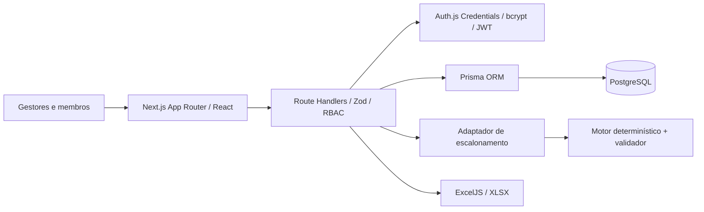

# BlueScale — Fase 1: Arquitetura

## Objetivo e limites

Sistema multiusuário destinado à Gestão de Pessoas de atléticas. O banco PostgreSQL é fonte de verdade. Next.js concentra web app e API REST; a geração de escala é **pura** e desacoplada do banco. Uma futura implementação OR-Tools poderá substituir o motor mantendo DTOs e validador.

## Módulos

| Módulo | Responsabilidade | Fase |
|---|---|---|
| Identity | Login, hash de senha, sessão e RBAC por endpoint | 2 |
| People | Cadastros, diretorias, competências, preferências, importação | 2 (básico) |
| Events | Evento, postos e turnos no horário de Brasília | 2 |
| Availability | Intervalos declarados; negar por omissão | 2 |
| Scheduler | Escolha determinística, bloqueios, conflitos, cobertura, versão | 2 |
| Reports | Exportação XLSX com cinco abas | 2 |
| Equity Optimization | Histórico, CP-SAT, pesos, explicabilidade avançada | 3 |
| Event Operations | Trocas, confirmação, presença, notificações | 4 |
| Hardening | testes E2E completos, observabilidade, rate limit distribuído | 5 |

## Relações principais

- `User` 0..1 → `Member` (credencial e perfil separados da ficha).
- `Department` 1..N → `Member`; `Member` N..M `Skill` por `MemberSkill`.
- `Member` 1..N → `MemberAvailability` (por evento); `Member` 0..1 `MemberPreference`.
- `Event` 1..N `Workstation` 1..N `Shift` N..M `Skill` por `ShiftRequirement`.
- `Event` 1..N `ScheduleVersion` 1..N `ShiftAssignment` (cada atribuição liga um membro e um turno).
- `ScheduleVersion` 1..N `ScheduleGeneration` (diagnósticos persistidos); `AuditLog` registra mutações relevantes.
- Entidades de operação futura já modeladas: `Confirmation`, `SwapRequest`, `Attendance`.

## Fluxo de escrita de escala

1. Uma rota autentica o usuário e exige `ADMIN` ou `PEOPLE`.
2. Ela carrega evento, habilidades, disponibilidade, turnos e versão dentro de transação `Serializable`.
3. O adaptador converte datas em ISO 8601 UTC e passa DTOs para o motor puro.
4. O algoritmo valida as atribuições travadas, distribui pessoas sem ferir restrições e retorna `uncovered`.
5. A API persiste nova revisão e auditoria. Em edições manuais, usa `revision` para rejeitar alterações concorrentes com HTTP 409.
6. Publicação revalida todas as atribuições; se faltar cobertura mínima, exige confirmação explícita. Versão publicada não pode ser editada.

## Decisões de dados e horários

- Datas chegam do navegador como horário de Brasília e são convertidas para UTC com `date-fns-tz`. As datas são armazenadas como `DateTime` e exibidas com timezone `America/Sao_Paulo`.
- A disponibilidade é **positiva**: sem intervalo disponível, não se escala. Um bloqueio explícito intersectando o turno o desabilita.
- Nenhuma posição residencial precisa, endereço pessoal completo ou informação sobre consumo de álcool é armazenada.
- Versões antigas publicadas tornam-se `ARCHIVED` apenas após nova publicação. Rascunhos são editáveis; esta implementação permite somente um rascunho por evento.
- Integridade de duplicidade garantida por índices únicos e controle transacional. Exclusão de sobreposição por `EXCLUDE` no PostgreSQL requer denormalização dos intervalos; no MVP, o validador e transações serializáveis protegem as rotas da aplicação, não escritas arbitrárias diretamente no banco.
